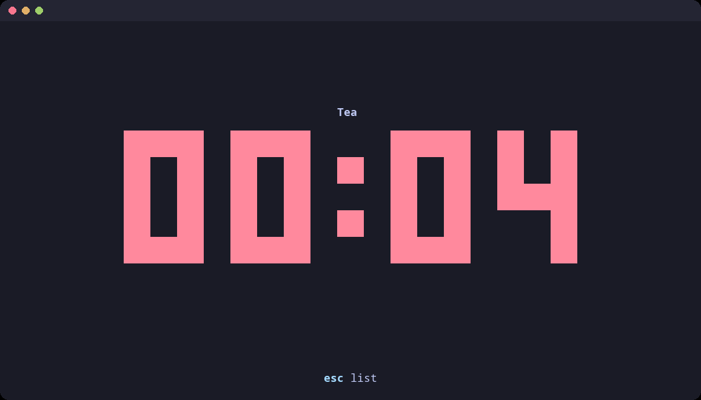

# tock

A countdown timer and stopwatch that fills the terminal with big ASCII-art digits.
One static binary for Linux on x86_64 or aarch64, with no runtime dependencies.




## Install

```sh
mkdir -p ~/.local/bin && curl -fsSL "https://github.com/marcusbandit/ascii-countdown/releases/latest/download/tock-$(uname -m)-linux.tar.gz" | tar -xz -C ~/.local/bin tock
```

That puts `tock` in `~/.local/bin`. The tarball also holds tab completion for zsh
and bash in `completions/`. Copy `_tock` to a directory on your `$fpath`, and
`tock.bash` to `~/.local/share/bash-completion/completions/tock`.

## Use

```sh
tock 25m              # count down 25 minutes
tock 1h30m            # or 90s, 1h2m3s, 45 (seconds)
tock 10:00            # mm:ss, or h:mm:ss as in 1:30:00
tock -t "Tea" 4m      # with a title above the clock
tock stopwatch        # count up from zero, same as tock --up
```

| Key | Does |
| --- | --- |
| space | pause or resume |
| r | reset to the start, keeping it paused or running |
| q, Esc, Ctrl+C | quit |

The digits scale to the largest size that fits and re-center when the window
changes size. In the last ten seconds a countdown turns red. At zero the screen
flashes red for four seconds and the terminal bell rings three times
(`--no-bell` keeps it silent). Once it has hit zero, any key quits.

`tock` draws on the terminal itself, so stdout is free for scripts. The
stopwatch prints the time it stopped at, and a countdown exits 0 only when it
reached zero:

```sh
tock 25m && notify-send "Take a break"
lap=$(tock stopwatch)
```

Exit codes: 0 finished, 1 countdown quit early, 2 bad arguments, 130 interrupted.
Set `NO_COLOR` to draw without colors.

## Build from source

```sh
cargo build --release                               # target/release/tock
cargo test                                          # unit tests
scripts/smoke.sh target/release/tock                # drives it in a headless tmux
scripts/screenshot.sh target/release/tock           # remakes the images in docs/
```

## License

MIT
