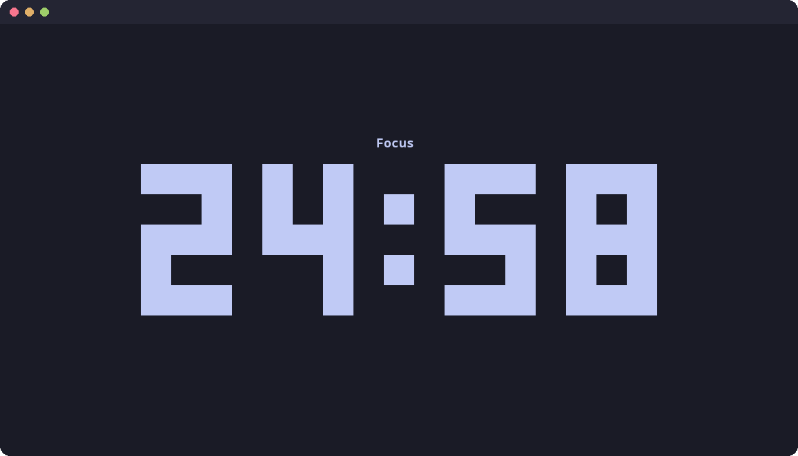
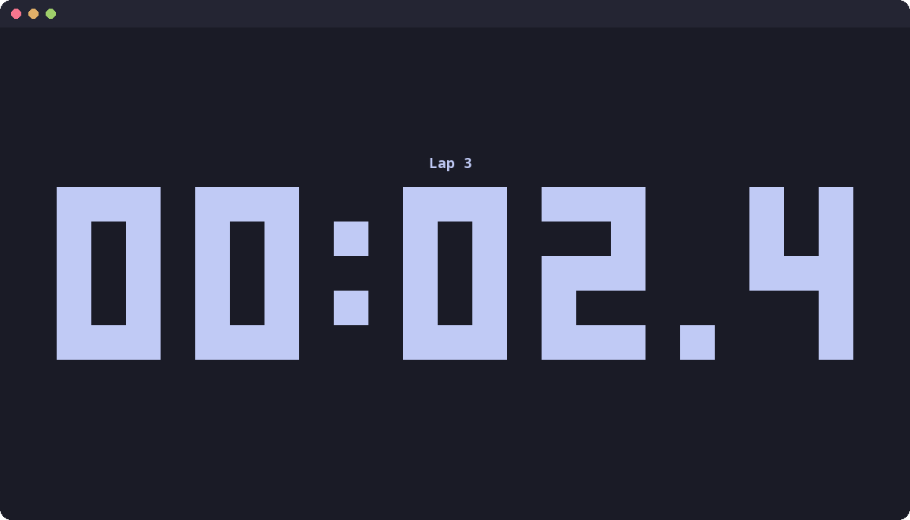
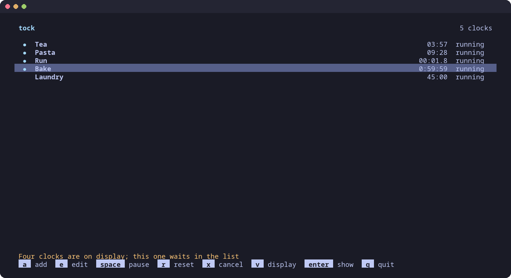
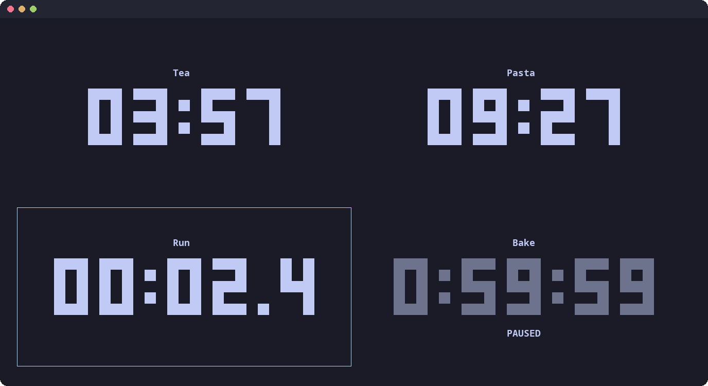

# tock

```sh
curl -fsSL https://raw.githubusercontent.com/marcusbandit/ascii-countdown/main/install.sh | sh
```

A countdown timer and stopwatch that fills the terminal with big ASCII-art digits.
One static binary for Linux on x86_64 or aarch64, with no runtime dependencies.






## Install

The line at the top runs [install.sh](install.sh), which picks the build for
your CPU, checks its sha256 and puts `tock` in `~/.local/bin`, with zsh and
bash completion under `~/.local/share`.
Set `TOCK_BIN_DIR` to install somewhere else, or `TOCK_VERSION=0.1.0` to pin a
release: `curl -fsSL .../install.sh | TOCK_VERSION=v0.1.0 sh`.

zsh only loads that completion when `~/.local/share/zsh/site-functions` is on
`$fpath` before `compinit` runs.

Without the script, grab the tarball for your machine from the
[releases page](https://github.com/marcusbandit/ascii-countdown/releases) and
copy `tock` onto your `PATH`. Its `completions/` folder holds `_tock` for a
directory on your zsh `$fpath` and `tock.bash` for
`~/.local/share/bash-completion/completions/tock`.

## Use

Run `tock` on its own to open the clock list. `a` adds a clock: give it a name
and press Enter for a stopwatch, or switch its type to countdown and type a
time. Up to four clocks
are shown at once, and Enter puts them full screen in big digits.





Or start clocks straight from the command line, which skips the list:

```sh
tock 25m              # count down 25 minutes
tock 1h30m            # or 90s, 1h2m3s, 45 (seconds)
tock 10:00            # mm:ss, or h:mm:ss as in 1:30:00
tock -t "Tea" 4m      # with a title above the clock
tock stopwatch        # count up from zero, same as tock --up
tock -t Tea 4m -t Pasta 10m stopwatch   # up to four; each -t names the next
```

On the list:

| Key | Does |
| --- | --- |
| j k, arrows | move |
| enter | full screen, with the selected clock shown |
| v | show or hide the selected clock |
| a, e | add a clock, edit the selected one (name, type, time) |
| space, r, x | pause, reset, cancel the selected clock |
| P, R | pause or resume all, reset all |
| q | quit |

Full screen:

| Key | Does |
| --- | --- |
| h j k l, arrows | move between clocks |
| space, r, x, e | pause, reset, cancel, edit the selected clock |
| a | add a clock |
| P, R | pause or resume all, reset all |
| esc | back to the list |
| q | quit |

Moving shows a frame around the selected clock. It hides after ten seconds
without a key, and the keys still act on that clock.

The digits scale to the largest size that fits and re-center when the window
changes size; a terminal too small for four shows fewer and follows the
selection. In the last ten seconds a countdown turns red. At zero its panel
flashes red for four seconds and the terminal bell rings three times
(`--no-bell` keeps it silent), while the other clocks keep going. Once every
countdown has hit zero, keys with no job there quit.

`tock` draws on the terminal itself, so stdout is free for scripts. Each
stopwatch prints the time it stopped at, one line each, and `tock` exits 0
only when no countdown was left running:

```sh
tock 25m && notify-send "Take a break"
lap=$(tock stopwatch)
```

Exit codes: 0 when no countdown was left running, 1 when one was, 2 bad
arguments, 130 interrupted.
Set `NO_COLOR` to draw without colors.

## Build from source

```sh
cargo build --release                               # target/release/tock
cargo test                                          # unit tests
scripts/smoke.sh target/release/tock                # drives it in a headless tmux
scripts/screenshot.sh target/release/tock           # remakes the images in docs/
```

## License

MIT
